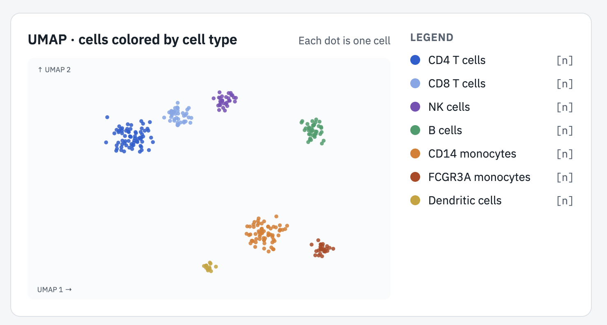
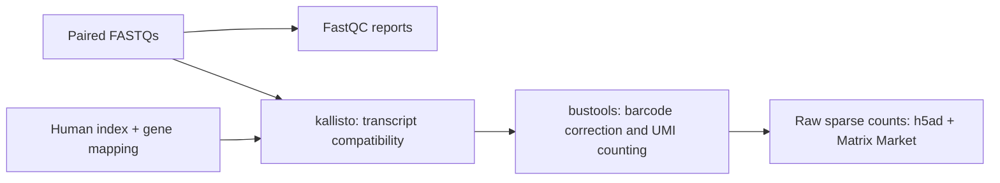

# PBMC: reads to cell types

> **Quick start** — Turn public 10x PBMC reads into gene counts and annotated cell types with FastQC, kb-python, Scanpy, and CellTypist.<br>
> **1,107 cells passing QC · 13 Leiden clusters** in the completed analysis.<br>
> After [one-time setup](docs/stage-3.md#prepare-once), run `nextflow run main.nf -profile test,docker`.


*Illustrative cell-type overview; the image uses placeholder counts. See the [executed notebook](notebooks/01_explore.ipynb) for the measured UMAP and labels.*

A portfolio project demonstrating reproducible single-cell RNA-seq engineering:
public 10x Genomics FASTQ reads → gene counts → quality-controlled, annotated
cells → an interactive dashboard, with a laptop-sized memory budget.

## Current stage

**Stage 3:** the containerized Nextflow pipeline runs FASTQs through FastQC,
kb count, Scanpy QC/clustering, CellTypist annotation and MultiQC.
See the [setup and design walkthrough](docs/stage-3.md). The
[Stage 2 notebook](notebooks/01_explore.ipynb) remains the exploratory record;
the Python scripts in `bin/` are the analysis source of truth.

```bash
nextflow run main.nf -profile test,docker
nextflow run main.nf -profile test,docker -resume
nextflow run main.nf -profile docker
```

The test profile uses 500,000 read pairs per lane, seed 42, and writes to
`results/test-pipeline/`. The full run writes `results/analysis/annotated.h5ad`,
`results/analysis/markers.csv`, figures and MultiQC, with a convenience copy at
`results/annotated.h5ad`. Downloads, image builds and fixture creation are one-time
setup steps. Preserve `.nextflow/cache` and `work/nextflow-tasks` for resume.

### How the pipeline is organized

`main.nf` groups lanes by sample and connects one process per step in `modules/`.
`nextflow.config` holds parameters, CPU/memory allocations, pinned image names
and test/Docker/Slurm profiles. `bin/` scripts accept explicit CLI parameters;
`containers/` builds the shared analysis image and repaired kb image. Each process
runs in a separate container. Outputs are published into `counts/`, `analysis/`,
`figures/`, `fastqc/`, `multiqc/` and `pipeline_info/` under the output directory.

Scrublet flags potential doublets by default; removal is a separate opt-in.
The existing Ensembl 108 reference is checksum-verified, and a missing reference
is downloaded into a persistent cache. The Slurm/Apptainer profile is a scaffold
and has not been tested. Dashboard, pytest and CI remain future stages.

## Stage 1

Follow [the command-by-command walkthrough](docs/stage-1.md). All processing
parameters are in `nextflow.config`; the walkthrough uses Nextflow only to read
that configuration. FastQC and `kb count` are invoked directly from the shell.

The target laptop has 24 GB RAM. Counts are sparse UMI counts, not normalized
expression values. A barcode with reads is not necessarily a real cell.

## Stage 1 data flow



FastQC inspects reads without modifying them. The count matrix has barcode rows
and gene columns; selecting real cells and assigning cell types comes in Stage 2.

## Roadmap

1. Repository, environment, provenance, paired FASTQ subset, manual FastQC and counts.
2. Interactive Scanpy analysis and CellTypist Immune_All_Low annotation.
3. Nextflow modules, separate pinned containers, and a small test profile.
4. Streamlit/Plotly dashboard, including mobile layout.
5. pytest, GitHub Actions, measured limits, screenshots, and polished documentation.
6. One optional add-on, selected later.

## Layout

```text
main.nf                 Strict-syntax Nextflow workflow
nextflow.config         Central processing parameters
samplesheet.csv         One row per sequencing lane, grouped by sample
environment.yml         Pinned Stage 1 Python/QC environment
environment-native.yml  Mac HDF5 dependency and bustools
environment-stage2.yml  Pinned interactive analysis environment
notebooks/              Executed Scanpy and CellTypist walkthrough
modules/                One process per pipeline step
containers/             Pinned image builds and dependency locks
bin/                    Parameterized analysis and validation scripts
dashboard/              Future Streamlit application
addons/                 Reserved for the later add-on
tests/                  Seeded fixture builder and test samplesheet
docs/                   Walkthrough, provenance, and run evidence
data/                   Ignored raw reads and derived test fixture
references/             Ignored prebuilt index and gene mapping
results/                Ignored reports, matrices, annotated h5ad, and figures
work/                   Ignored local environment, downloads, and logs
```

## Data and attribution

[1k PBMCs from a Healthy Donor (v3 chemistry), 10x Genomics](https://www.10xgenomics.com/datasets/1-k-pbm-cs-from-a-healthy-donor-v-3-chemistry-3-standard-3-0-0),
published November 19, 2018, licensed CC BY 4.0. The vendor reported 1,222 cells;
that is contextual information, not an expected identical output for this workflow.
The test reads are a subsampled derivative, with the seed recorded.

Reference: [Pachter lab prebuilt kallisto indices, release v1](https://github.com/pachterlab/kallisto-transcriptome-indices/releases/tag/v1),
human GRCh38 / Ensembl 108, standard transcriptome index. See
[reference construction details](https://github.com/pachterlab/kallisto-transcriptome-indices).

## Known limits at this stage

- Random read subsampling reduces depth across barcodes; it does not select a
  fixed number of cells. Test-fixture labels will not validate biological accuracy.
- The standard reference quantifies mature transcripts and omits intronic signal.
- The reference uses a documented subset of gene biotypes, not every genomic feature.
- Some reference gene symbols are missing or shared by multiple IDs. The notebook
  records and aggregates shared symbols explicitly; original Ensembl IDs are preserved.
- Barcode filtering and cell QC are distinct decisions. Retain unfiltered counts
  so the notebook and pipeline can inspect barcode ranks before cell selection.
- Test runtime excludes downloads, image builds and fixture preparation; a fresh
  execution and a `-resume` cache hit are measured separately in the Stage 3 record.
