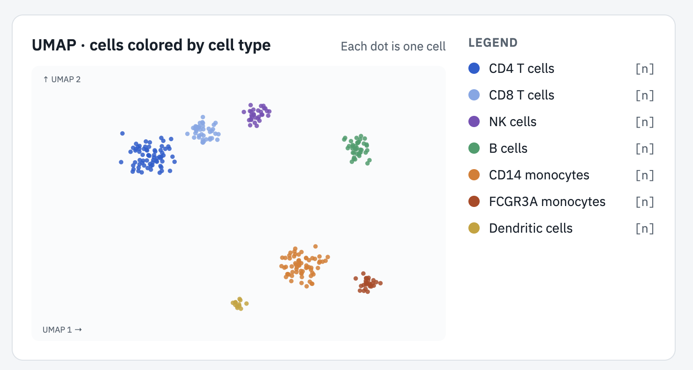
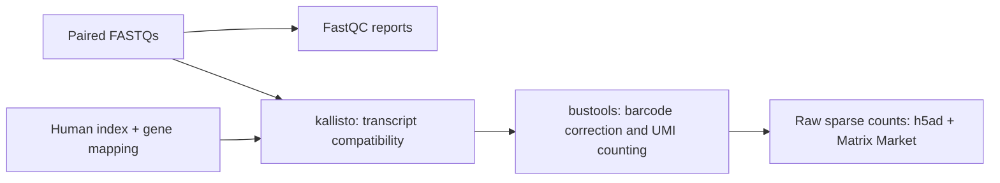

# PBMC: reads to cell types

> **Quick start** — Turn public 10x PBMC reads into gene counts and annotated cell types with FastQC, kb-python, Scanpy, and CellTypist.<br>
> **1,107 cells passing QC · 13 Leiden clusters** in the completed analysis.<br>
> Follow the [Stage 2 setup](docs/stage-2.md), then run `work/envs/stage2/bin/jupyter notebook notebooks/01_explore.ipynb` and select **Restart Kernel and Run All Cells**.


*Illustrative cell-type overview; the image uses placeholder counts. See the [executed notebook](notebooks/01_explore.ipynb) for the measured UMAP and labels.*

A portfolio project demonstrating reproducible single-cell RNA-seq engineering:
public 10x Genomics FASTQ reads → gene counts → quality-controlled, annotated
cells → an interactive dashboard, with a laptop-sized memory budget.

## Current stage

**Stage 2 complete:** the [interactive Scanpy/CellTypist notebook](notebooks/01_explore.ipynb)
runs top to bottom and produces `results/annotated.h5ad` with 1,107 QC-passing cells
and 13 Leiden clusters. Read the [cluster review and validation](docs/stage-2-results.md)
and [Jupyter launch instructions](docs/stage-2.md).

Stage 1 full/test counts and QC remain documented in the
[Stage 1 run record](docs/stage-1-results.md).

The repository is being built in reviewable stages. Stop here for review before
Nextflow modules and Docker. The automated workflow, containers, dashboard, pytest suite, and CI
are future stages.

The eventual entry point is:

```bash
nextflow run main.nf -profile test,docker
```

That command is a Stage 3 deliverable, not a working quick start today.

## Stage 1

Follow [the command-by-command walkthrough](docs/stage-1.md). All processing
parameters are in `nextflow.config`; the walkthrough uses Nextflow only to read
that configuration. FastQC and `kb count` are invoked directly from the shell.

The target laptop has 24 GB RAM. Counts are sparse UMI counts, not normalized
expression values. A barcode with reads is not necessarily a real cell.

## Stage 1 data flow



FastQC inspects reads without modifying them. The count matrix has barcode rows
and gene columns; selecting real cells and assigning cell types comes in Stage 2.

## Roadmap

1. Repository, environment, provenance, paired FASTQ subset, manual FastQC and counts.
2. Interactive Scanpy analysis and CellTypist Immune_All_Low annotation.
3. Nextflow modules, separate pinned containers, and a small test profile.
4. Streamlit/Plotly dashboard, including mobile layout.
5. pytest, GitHub Actions, measured limits, screenshots, and polished documentation.
6. One optional add-on, selected later.

## Layout

```text
main.nf                 Stage 3 entry-point placeholder
nextflow.config         Central processing parameters
samplesheet.csv         One row per sequencing lane, grouped by sample
environment.yml         Pinned Stage 1 Python/QC environment
environment-native.yml  Mac HDF5 dependency and bustools
environment-stage2.yml  Pinned interactive analysis environment
notebooks/              Executed Scanpy and CellTypist walkthrough
modules/                Future Nextflow modules
containers/             Future per-process Dockerfiles
bin/                    Input/output validators; future analysis scripts
dashboard/              Future Streamlit application
addons/                 Reserved for the later add-on
tests/                  Future pytest suite
docs/                   Walkthrough, provenance, and run evidence
data/                   Ignored raw reads and derived test fixture
references/             Ignored prebuilt index and gene mapping
results/                Ignored reports, matrices, annotated h5ad, and figures
work/                   Ignored local environment, downloads, and logs
```

## Data and attribution

[1k PBMCs from a Healthy Donor (v3 chemistry), 10x Genomics](https://www.10xgenomics.com/datasets/1-k-pbm-cs-from-a-healthy-donor-v-3-chemistry-3-standard-3-0-0),
published November 19, 2018, licensed CC BY 4.0. The vendor reported 1,222 cells;
that is contextual information, not an expected identical output for this workflow.
The test reads are a subsampled derivative, with the seed recorded.

Reference: [Pachter lab prebuilt kallisto indices, release v1](https://github.com/pachterlab/kallisto-transcriptome-indices/releases/tag/v1),
human GRCh38 / Ensembl 108, standard transcriptome index. See
[reference construction details](https://github.com/pachterlab/kallisto-transcriptome-indices).

## Known limits at this stage

- Random read subsampling reduces depth across barcodes; it does not select a
  fixed number of cells. Test-fixture labels will not validate biological accuracy.
- The standard reference quantifies mature transcripts and omits intronic signal.
- The reference uses a documented subset of gene biotypes, not every genomic feature.
- Some reference gene symbols are missing or shared by multiple IDs. The notebook
  records and aggregates shared symbols explicitly; original Ensembl IDs are preserved.
- Barcode filtering and cell QC are distinct decisions. Retain unfiltered counts
  so the notebook can examine the barcode-rank distribution before cell selection.
- Under five minutes is a future measured target for a fresh test execution with
  inputs, references, models, and images already cached. It is not a claim about
  download time or a Nextflow `-resume` cache hit.
