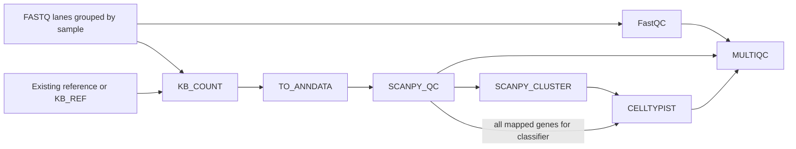

# Stage 3: container pipeline

Stage 2 remains an exploratory record. `bin/` scripts are now the executable
analysis source of truth; `nextflow.config` supplies every exposed setting.
The defaults preserve the notebook's QC, normalization, HVG, graph and annotation
choices. No dashboard, pytest suite or GitHub Actions is added in this stage.

## Prepare once

Install Docker Desktop and Nextflow 26.10.5 (Java 17 or newer). Start Docker.
The tested Mac has 24 GB physical RAM; Docker is configured with 10 CPUs and about
8 GB RAM. All containers target `linux/amd64`, so Apple Silicon executes them
through emulation. Expect slower execution than native ARM tools; actual measured
runtimes are recorded separately. Image builds, downloads and fixture preparation
are setup costs, not included in the timed pipeline runs.

For this repository's existing Java installation, use:

```bash
export JAVA_HOME="$PWD/work/envs/stage2/lib/jvm"
export NXF_HOME="$PWD/work/nextflow"
export NXF_VER=26.10.5
bash containers/build.sh
```

The analysis Dockerfile uses micromamba for Python 3.11.11 and installs pinned
Scanpy/AnnData/CellTypist/Scrublet dependencies. Its complete Linux dependency lock, used by the build, is `containers/analysis/requirements.lock.txt`. The Immune_All_Low v2 model
is downloaded and SHA-256 checked at build time. Annotation needs no internet.
FastQC 0.12.1 and MultiQC 1.27 use digest-pinned BioContainers images directly.
The kb-python 0.30.2 BioContainer required a thin repair Dockerfile: its bundled
executables could not load `libstdc++.so.6` and `libz.so.1`. These are copied from
the analysis image; the bundled bustools 0.45.1 is retained. The upstream Linux image bundled kallisto
0.52.0, which changed pseudoalignment counts. We explicitly install the official,
checksum-verified kallisto 0.51.1 Linux binary to match Stage 1.

Use the full reads and frozen reference prepared in [Stage 1](stage-1.md).
To recreate the fixture, put seqtk 1.4 and Python on PATH, then:

```bash
export PATH="$PWD/work/envs/stage1/bin:$PATH"
bash tests/make_test_data.sh
```

This selects 500,000 read pairs from each of two lanes using seed 42 for both
mates. The script validates every paired identifier and writes
`tests/samplesheet_test.csv`. The four compressed FASTQs total about 75 MB and
remain ignored in `data/test/`; committing the generation script and samplesheet
keeps Git small. Fixture preparation scans the full FASTQs and is not a timed
pipeline step. The checked-in Stage 1 fixture was reused after validation.

## Run

```bash
nextflow run main.nf -profile test,docker
nextflow run main.nf -profile test,docker -resume
nextflow run main.nf -profile docker
```

The test profile writes to `results/test-pipeline/` and relaxes only cell QC:
50–5,000 genes, 100–30,000 UMIs and at most 30% mitochondrial UMIs. The full run
uses the notebook's 200–5,000 genes, 1,000–30,000 UMIs and at most 20% mitochondrial
UMIs. The tiny fixture checks execution, not reliable biological annotation.
Pass `--outdir` to choose another output folder. For the default PBMC sample:

```text
<outdir>/
├── annotated.h5ad                  Convenient alias for the default sample
├── counts/<sample>/counts.h5ad     All mapped, unfiltered raw UMI counts
├── analysis/annotated.h5ad         Requested final path, default sample
├── analysis/markers.csv            Requested marker table, default sample
├── analysis/<sample>/              Per-sample matrices, labels and tables
│   └── qc/                        Barcode QC and doublet records
├── figures/<sample>/{qc,cluster,annotation}/
├── fastqc/<sample>/                Per-FASTQ HTML and ZIP reports
├── multiqc/                        Aggregated HTML report and data
└── pipeline_info/                  Trace, report, timeline and DAG
```

Per-sample directories prevent collisions when the samplesheet contains multiple
samples. The top-level convenience copies are only for `params.sample_id`.
Relative FASTQ paths are resolved from the launch directory; run at the repo root.
A `lane` column is allowed but not required. All lanes of a sample are counted
together; independent samples remain separate analyses (no integration).

## How the pipeline is organized



- **FASTQC** checks read quality without trimming or removing duplicates.
- **KB_COUNT** pseudoaligns transcripts and collapses barcode/gene/UMI records.
  The output is reopened and validated; an exit code alone is insufficient for kb.
- **TO_ANNDATA** maps Ensembl IDs using t2g, retains IDs without symbols and sums
  duplicate symbols. It checks that every barcode's UMI total is preserved.
- **SCANPY_QC** measures genes, counts and mitochondrial UMI percentage before
  filtering. It saves thresholds in `uns['qc_params']`, plots and barcode decisions.
- **SCANPY_CLUSTER** normalizes to 10,000, log-transforms, selects HVGs, scales only
  the HVG copy, runs PCA, builds neighbors, Leiden/UMAP and Wilcoxon markers.
  Raw counts are retained in `.layers['counts']`; `.raw` contains log expression.
- **CELLTYPIST** uses all mapped genes normalized independently, then majority votes
  in seeded fine graph clusters. Its model score is not a calibrated probability
  for the voted label. PBMC and follow-up marker plots support manual review.
- **MULTIQC** waits for all samples and combines read QC and cell QC in one report.

Each process runs in a separate container, with the four Python processes sharing
the same analysis image. `tag` identifies the sample in logs. Resource `label`s
select CPU/memory settings from config. `tuple val(meta), path(file)` couples
sample metadata to a staged file; named `emit`s make connections readable.
`groupTuple()` gathers all FASTQ pairs for each sample. `join()` reconnects
clustered cells to the matching all-gene count matrix. `collect()` waits for all
reports before MultiQC. `def` declares local variables; closures explicitly name
their arguments. The files pass strict syntax without the obsolete DSL flag.

`publishDir` copies outputs to explicit destinations and is supported by the
pinned Nextflow release, though current Nextflow recommends workflow outputs for
new code. Here it keeps module-specific output layouts easy to inspect. Downstream
steps always consume emitted files, never asynchronously published copies.
Scripts themselves are process inputs, so edits invalidate the relevant cache.
Keep both `.nextflow/cache` and `work/nextflow-tasks` for `-resume`.

## Reference caching and reproducibility

`params.index` and `params.t2g` point at the existing Pachter v1 Ensembl 108 pair;
`--kb_index` is an optional index alias. Counting verifies their SHA-256 checksums
against `docs/inputs.sha256`. If the default files are missing, **KB_REF** downloads
the frozen archive and checks `docs/downloads.sha256` before extracting/validating
the pair. An explicitly supplied missing `--kb_index` fails rather than silently
using another reference. A changed reference also fails these frozen checksums.

The repo-specific requirement to retain Ensembl 108 takes precedence over the
general `kb ref -d human` suggestion, which can fetch a different reference.
`storeDir` persists the verified pair outside task work directories and avoids
repeat downloads even without `-resume`. Unlike the task cache, it reuses files
by existence rather than rechecking the producing command; therefore the cache
path names the reference release and KB_COUNT revalidates the bytes every time it
runs. `storeDir` is deprecated in Nextflow 26.10; it is retained here as requested.
The isolated reference check downloaded and verified the pair once, then reported
`Stored process` on a second run without `-resume`; logs are in `stage-3-validation/`.

The `manual_mac` profile holds the Stage 1 kallisto/bustools/library paths.
`docs/load-params.sh` selects it for the manual walkthrough. Container runs never
use Mac executables. The `slurm` profile scaffolds Slurm + Apptainer only; it has
not been run and requires publishing the locally built images to a registry (or
supplying compatible image locations) before use on a cluster.

## Doublets and comparison to Stage 2

`run_doublets=true` runs Scanpy's Scrublet implementation on raw counts after basic
cell QC. It simulates doublets and scores observed cells by their neighborhoods.
The 1% expected rate is an initial assumption for this approximately 1,000-cell
capture, not a measured doublet rate. The score threshold is inferred automatically
unless `--doublet_threshold` is supplied. The score/call table and chosen threshold
are saved. The library's remaining preprocessing defaults are pinned by Scanpy.

`remove_doublets=false` deliberately preserves the Stage 2 cell set for comparison:
flags are evidence to inspect, not proven doublets. To test their effect:

```bash
nextflow run main.nf -profile docker --remove_doublets true --outdir results/doublets-removed -resume
```

`--run_doublets false` reproduces the notebook's lack of doublet detection.
Seeds are fixed for Scrublet, PCA, graph construction, Leiden, UMAP and annotation
overclustering. BLAS/Numba threads are fixed in the image. Small numerical changes
between platforms can still alter graph partitions; compare cell membership and
markers, not just the arbitrary cluster numbers.

Official references: [strict syntax migration](https://docs.seqera.io/nextflow/migrations/26-04/),
[publishDir](https://docs.seqera.io/nextflow/reference/process/directives/publish-dir/),
[storeDir caveats](https://docs.seqera.io/nextflow/reference/process/directives/store-dir/),
and [Scanpy Scrublet](https://scanpy.readthedocs.io/en/stable/api/generated/scanpy.pp.scrublet.html).

## Parameters you are most likely to change

Pipeline flags retain the notebook's names, for example `--qc_min_genes 200`.
The corresponding Python script uses `--min-genes 200`; `main.nf` translates
between the two interfaces explicitly. Run any script with `--help` to inspect
its standalone interface. The test profile overrides only the three QC cutoffs
listed above; the seed and analysis choices stay the same.

| Config parameter(s) | Full-run default | Why this setting |
|---|---|---|
| `qc_min_genes`, `qc_max_genes` | 200, 5,000 | Exclude low-information barcodes and the high-gene tail seen during exploration. |
| `qc_min_counts`, `qc_max_counts` | 1,000, 30,000 | Keep the cell-rich side of the observed barcode-rank knee and exclude very high-count outliers. |
| `qc_max_pct_mt` | 20 | The notebook's candidate cells had about 10% median mitochondrial UMIs; a blanket 5% cutoff was too strict here. |
| `qc_gene_min_cells` | 3 | Remove extremely sparse genes from clustering while retaining the all-gene matrix for annotation. |
| `normalization_target` | 10,000 | Put cells on a common library-size scale and meet CellTypist's input convention before log1p. |
| `hvg_n_top_genes` | 2,000 | Focus PCA on informative genes; mitochondrial HVGs are excluded. |
| `pca_components`, `neighbors_n_pcs` | 50, 20 | Inspect the PCA tail but build the graph from the first 20 PCs, as in the notebook. |
| `neighbors_n_neighbors` | 15 | Preserve local structure without making each neighborhood too small. |
| `leiden_resolution` | 0.6 | Retain the exploratory clustering setting rather than tuning to force a desired cluster count. |
| `umap_min_dist` | 0.3 | Controls visual compactness; UMAP coordinates do not determine the Leiden clusters. |
| `celltypist_overcluster_resolution` | 5.0 | Vote in smaller graph groups rather than assigning one label to each large Leiden cluster. |
| `celltypist_min_prop` | 0.5 | Require at least half a voting group's cells to support its majority label. |
| `seed` | 42 | Reproduce randomized algorithm choices and the established FASTQ fixture. |

The 10,000 normalization target is enforced at annotation because the selected
CellTypist model expects that scale. Changing reference/model releases requires
reviewing their checksum pins, not merely changing a filename.
